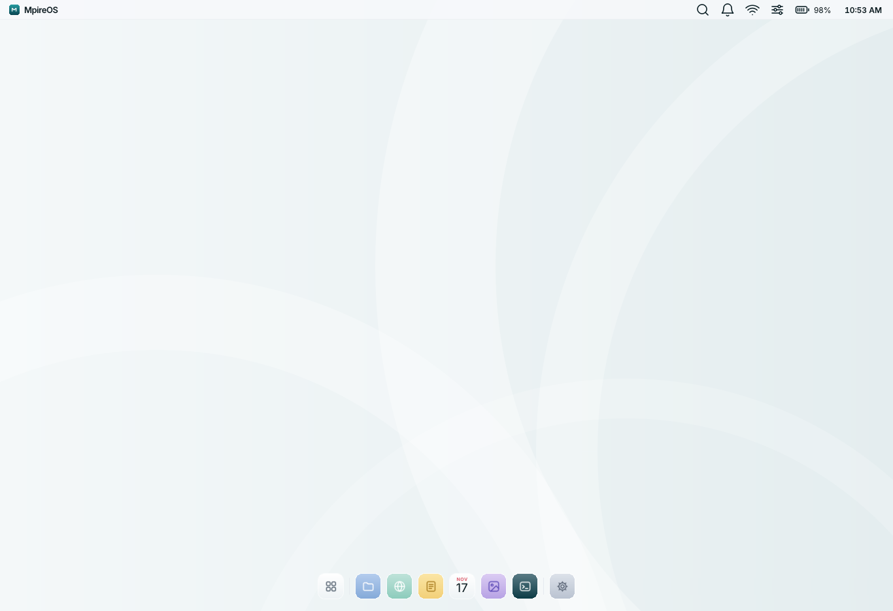
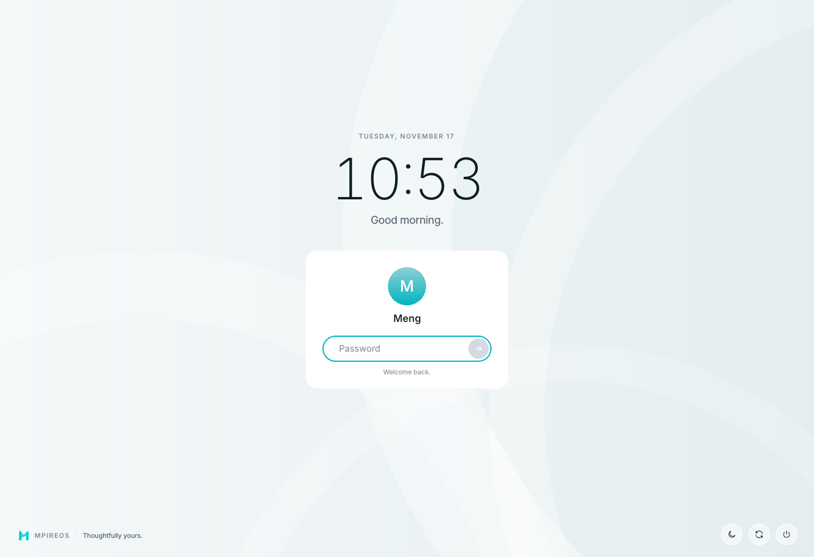
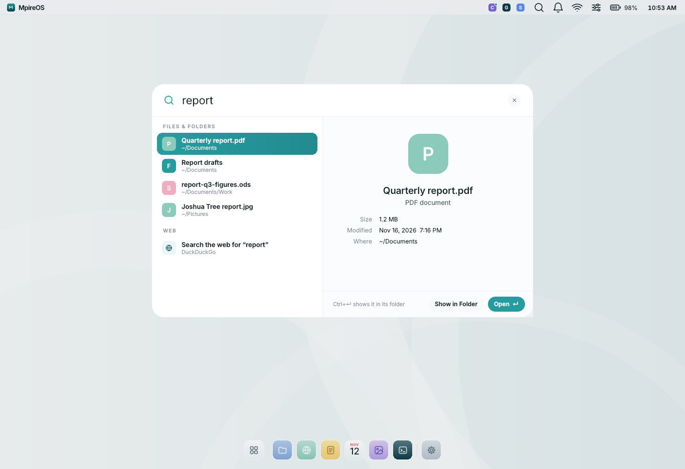
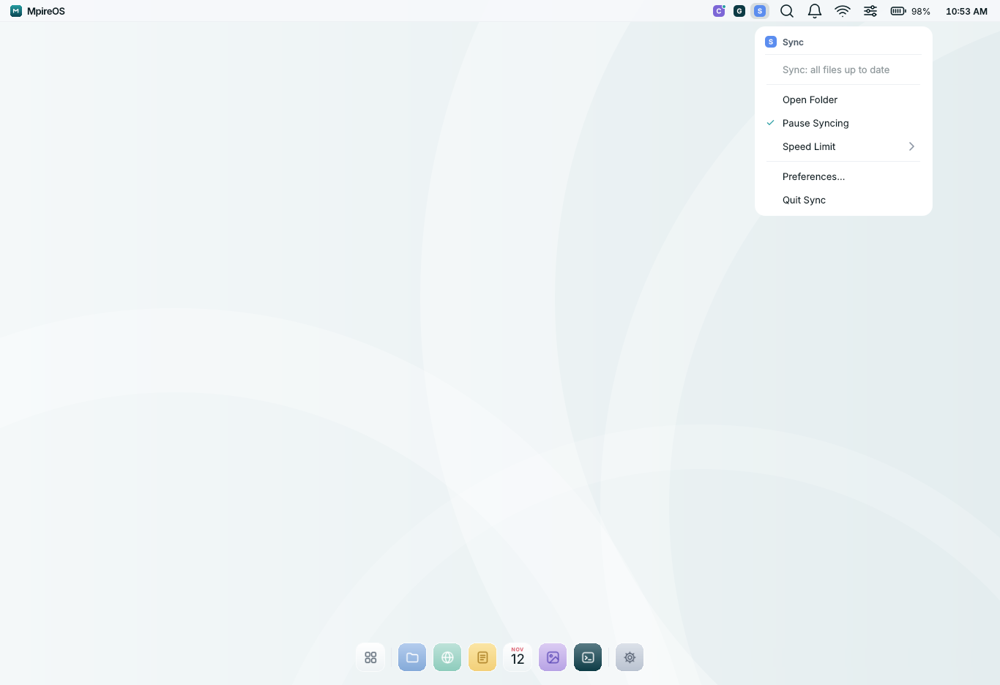
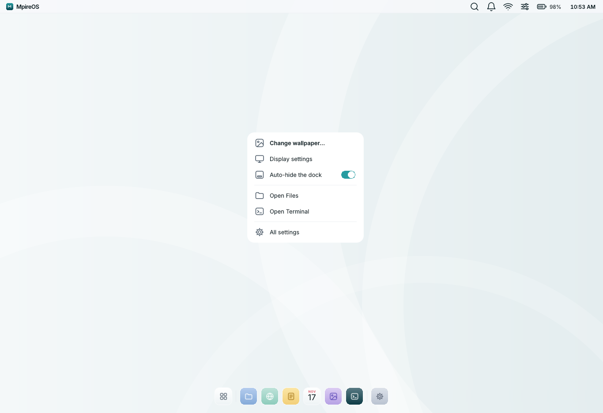
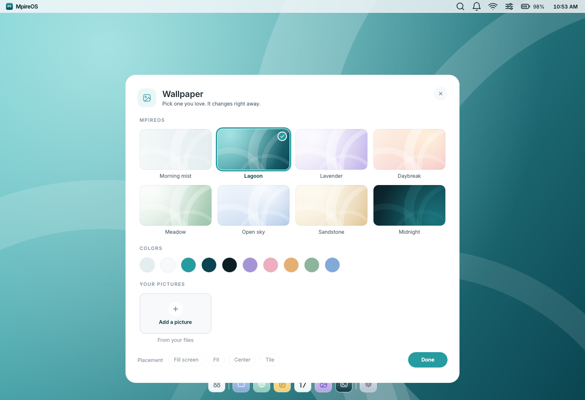

# Mpire Desktop

MpireOS's own desktop environment. See [docs/architecture.md](../docs/architecture.md#desktop-mpire-desktop) for how it fits together and [docs/design-system.md](../docs/design-system.md) for the look.

## Status: running on the ISO

Mpire Desktop is what you see after booting MpireOS:

- **`mpire-shell`** (`src/`) draws the desktop (just the wallpaper), the top bar, the dock (which hides itself and slides up when the pointer reaches the bottom edge), the launcher, notifications, and quick settings as Wayland layer-shell surfaces. For now it runs inside the Plasma session in place of `plasmashell` (a systemd drop-in, `session/mpire-shell.conf`), so KWin and the Plasma apps keep working underneath.
- **The login screen** (`greeter/`) is the SDDM theme `mpireos`, selected by `session/30-mpire-theme.conf`.
- Both are in the `mpire-desktop` package (`packages/mpire-desktop`), which also installs the shared `MpireOS.Style` QML module.

What works: the clock and date, battery level (hidden on desktops), and launching from the dock. Also:

- **Universal search** (Meta+Space, the search icon in the top bar, or KRunner's Alt+Space and Alt+F2): one field for apps, files and folders in your home folder, settings pages, system actions (lock, sleep, log out, restart, shut down), math, unit conversions ("10 km in miles", "72 f to c", "2.5 GB in MB", "15% of 80"), and web search. Results come in sections with a Top Hit, and the selected one is previewed on the right (pictures show the picture). Enter opens, Ctrl+Enter shows a file in its folder, Ctrl+C copies an answer or a file's path. Files come from the shell's own index of your home folder (`src/filesearch.*`; hidden folders and build clutter are skipped). It replaces KRunner.
- **Launcher** (tapping Meta, or the dock's grid button): all installed apps in a grid; type to narrow them down.
- **System tray**: other apps' tray icons (Discord, Steam, Nextcloud, password managers, and so on) show in the top bar, left of MpireOS's own icons, newest leftmost, as on a Mac. Click for the app's main action, right-click for its menu, middle-click and scroll as the app defines. Menus are drawn by the shell, so every app's menu looks like Mpire Desktop's. `mpire-shell` is a StatusNotifierItem host (the protocol Qt, KDE, GTK/Ayatana, and Electron apps use) and runs the StatusNotifierWatcher itself when nothing else does; old XEmbed tray icons come through `xembedsniproxy`. Apps that say they are idle ("Passive") are hidden until they have something to show. `/usr/lib/mpire-desktop/mpire-tray-test` puts a test icon in the tray.
- **Notifications**: `mpire-shell` is the session's notification server (`org.freedesktop.Notifications`). Popups show at the top right; the bell in the top bar opens the list, with Clear all and Do not disturb.
- **Quick settings** (the network or sliders icon in the top bar): Wi-Fi on/off, Do not disturb, volume, screen brightness, battery, and lock, log out, restart, sleep, and shut down (these last ask first). It uses NetworkManager (`nmcli`), PipeWire (`wpctl`), and `brightnessctl`.
- **Desktop menu** (right-click on the desktop): Change wallpaper…, Display settings, Auto-hide the dock, Open Files, Open Terminal, and All settings.
- **Wallpaper picker**: MpireOS's own wallpapers (drawn in QML, `shell/wallpaper/`), solid colors, and your pictures (from `~/Pictures`, `~/Pictures/Wallpapers`, and the system's wallpaper folders, or any file through the system file chooser), with Fill, Fit, Center, or Tile. Choices apply right away and are saved in `~/.config/MpireOS/desktop.conf` (a distribution default can go in `/etc/xdg/MpireOS/desktop.conf`).
- `mpire-shell --show search|launcher|quick-settings|notifications|desktop-menu|wallpaper` opens a panel from a script; the shell is also on the session bus as `org.mpireos.Shell`.

Not yet: searching inside files (only names), an overflow menu for a crowded tray, tray tooltips, picking a Wi-Fi network inside quick settings (the arrow opens Settings), Bluetooth, a window list and running-app indicators in the dock, the active app's name and menus in the top bar, media controls (MPRIS), and multiple monitors (the shell uses the primary screen).

| Path | Contents |
|---|---|
| `style/MpireOS/Style/` | Shared design tokens (`Theme`), icons, text styles, cards, backdrop, the MpireOS mark |
| `shell/` | Top bar, dock, app icons, and `Desktop.qml` (the whole desktop as one scene, for previews) |
| `shell/wallpaper/` | The wallpaper, MpireOS's own wallpapers, and how pictures are placed |
| `shell/panels/` | Universal search, launcher, quick settings, notification cards and list, desktop menu, wallpaper picker, tray menus |
| `shell/search.js` | Search ranking, calculator, unit conversions, and web search (shared by universal search and the launcher) |
| `shell/surfaces/` | What `mpire-shell` actually shows: background, top bar, dock, panels, notification popups |
| `src/` | `mpire-shell` (C++, Qt 6, LayerShellQt), including the system tray host (`tray.*`) and the file index (`filesearch.*`) |
| `tests/tray-test.cpp` | `mpire-tray-test`, a stand-in app with a tray icon and menu |
| `greeter/` | The login screen, as an SDDM theme |
| `session/` | How the shell and login screen are switched on |
| `tools/preview.py` | Render any scene without a compositor |

## Previewing

```sh
pip install PySide6-Essentials
python3 desktop/tools/preview.py desktop
python3 desktop/tools/preview.py greeter --fake-sddm --shot login.png --time 2026-11-12T10:53
python3 desktop/tools/preview.py shell-dock --size 600x72
python3 desktop/tools/preview.py panels --panel search --query "report"
python3 desktop/tools/preview.py panels --panel tray-menu
python3 desktop/tools/preview.py panels --panel launcher --query "fi"
python3 desktop/tools/preview.py panels --panel quick-settings   # or notifications, popups
python3 desktop/tools/preview.py panels --panel desktop-menu --menu-at 500,260
python3 desktop/tools/preview.py panels --panel wallpaper --wallpaper mpire:lagoon --pictures ~/Pictures/*.jpg
```

| Desktop | Login screen |
|---|---|
|  |  |

| Universal search (Meta+Space) | A tray icon's menu |
|---|---|
|  |  |

| Desktop menu (right-click) | Wallpaper picker |
|---|---|
|  |  |

The offscreen renderer used for these screenshots does not draw drop shadows; on real hardware cards, the dock, and the login card have soft teal-tinted shadows.
