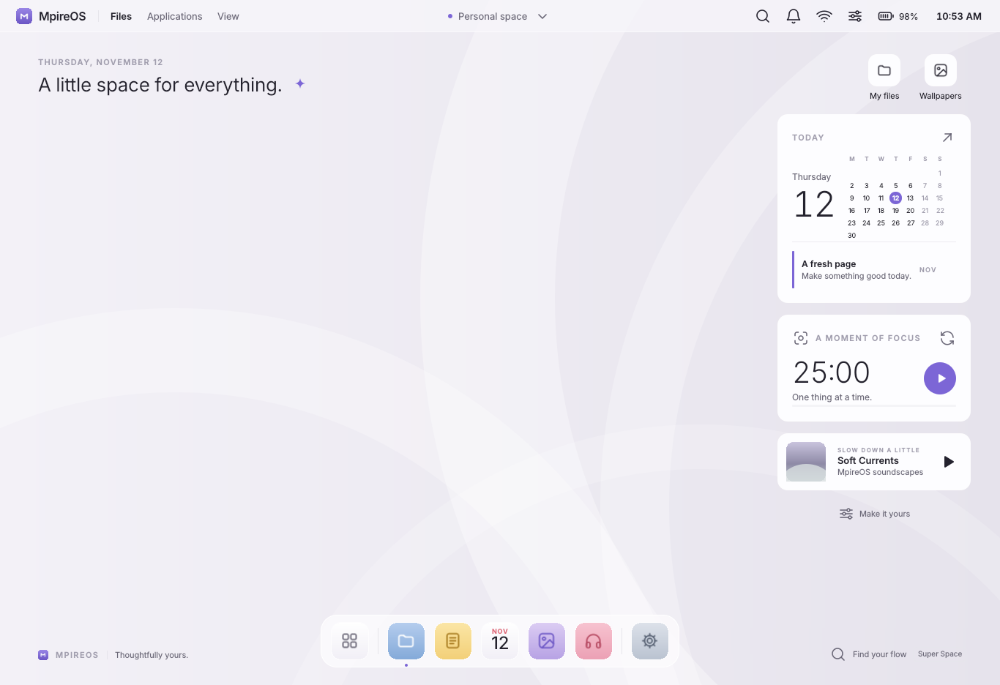
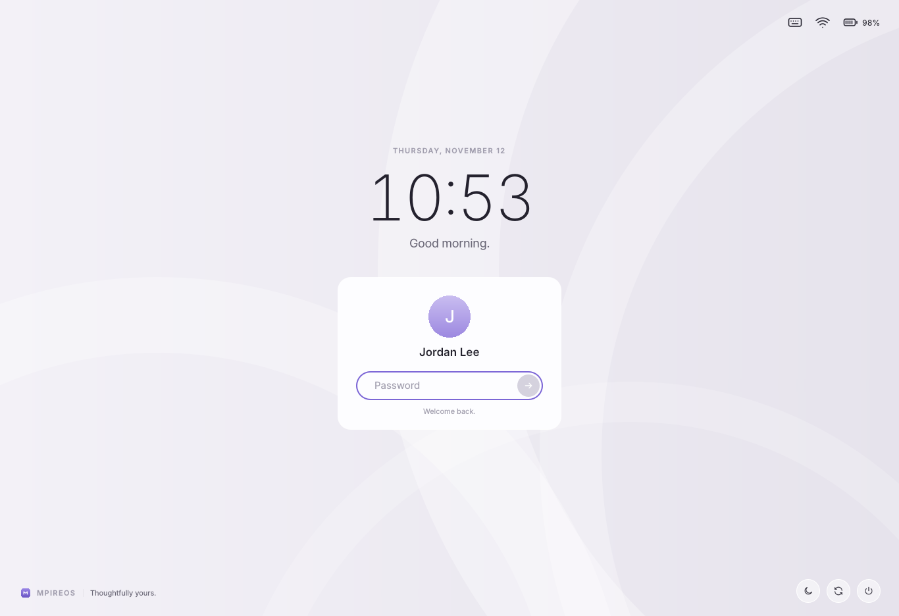

# Mpire Desktop

MpireOS's own desktop environment. See [docs/architecture.md](../docs/architecture.md#desktop-mpire-desktop) for how it fits together and [docs/design-system.md](../docs/design-system.md) for the look.

## Status: running on the ISO

Mpire Desktop is what you see after booting MpireOS:

- **`mpire-shell`** (`src/`) draws the desktop, the top bar, the dock, the launcher, notifications, and quick settings as Wayland layer-shell surfaces. For now it runs inside the Plasma session in place of `plasmashell` (a systemd drop-in, `session/mpire-shell.conf`), so KWin and the Plasma apps keep working underneath.
- **The login screen** (`greeter/`) is the SDDM theme `mpireos`, selected by `session/30-mpire-theme.conf`.
- Both are in the `mpire-desktop` package (`packages/mpire-desktop`), which also installs the shared `MpireOS.Style` QML module.

What works: the clock and date, greeting, Today calendar, focus timer, battery level (hidden on desktops), and launching from the dock and the desktop. Also:

- **Launcher** (Alt+Space, Alt+F2, tapping Meta, the dock's grid button, or the top bar's search): all installed apps, plus search across apps, settings pages, system actions (lock, sleep, log out, restart, shut down), a calculator, and web search. It replaces KRunner.
- **Notifications**: `mpire-shell` is the session's notification server (`org.freedesktop.Notifications`). Popups show at the top right; the bell in the top bar opens the list, with Clear all and Do not disturb.
- **Quick settings** (the network or sliders icon in the top bar): Wi-Fi on/off, Do not disturb, volume, screen brightness, battery, and lock, log out, restart, sleep, and shut down (these last ask first). It uses NetworkManager (`nmcli`), PipeWire (`wpctl`), and `brightnessctl`.
- `mpire-shell --show launcher|quick-settings|notifications` opens a panel from a script; the shell is also on the session bus as `org.mpireos.Shell`.

Not yet: searching files, picking a Wi-Fi network inside quick settings (the arrow opens Settings), Bluetooth, a window list and running-app indicators in the dock, the active app's name and menus in the top bar, media controls (MPRIS), multiple monitors (the shell uses the primary screen), and wallpaper choice.

| Path | Contents |
|---|---|
| `style/MpireOS/Style/` | Shared design tokens (`Theme`), icons, text styles, cards, backdrop, the MpireOS mark |
| `shell/` | Top bar, dock, app icons, widgets, and `Desktop.qml` (the whole desktop as one scene, for previews) |
| `shell/panels/` | Launcher, quick settings, notification cards and list |
| `shell/search.js` | The launcher's ranking, calculator, and web search |
| `shell/surfaces/` | What `mpire-shell` actually shows: background, top bar, dock, panels, notification popups |
| `src/` | `mpire-shell` (C++, Qt 6, LayerShellQt) |
| `greeter/` | The login screen, as an SDDM theme |
| `session/` | How the shell and login screen are switched on |
| `tools/preview.py` | Render any scene without a compositor |

## Previewing

```sh
pip install PySide6-Essentials
python3 desktop/tools/preview.py desktop
python3 desktop/tools/preview.py greeter --fake-sddm --shot login.png --time 2026-11-12T10:53
python3 desktop/tools/preview.py shell-dock --size 600x72
python3 desktop/tools/preview.py panels --panel launcher --query "fi"
python3 desktop/tools/preview.py panels --panel quick-settings   # or notifications, popups
```

| Desktop | Login screen |
|---|---|
|  |  |

The offscreen renderer used for these screenshots does not draw drop shadows; on real hardware cards, the dock, and the login card have soft teal-tinted shadows.
