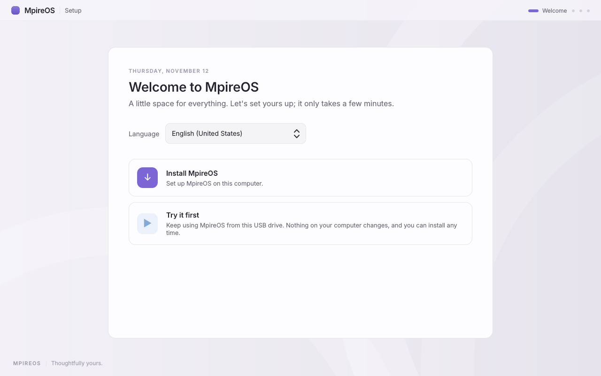
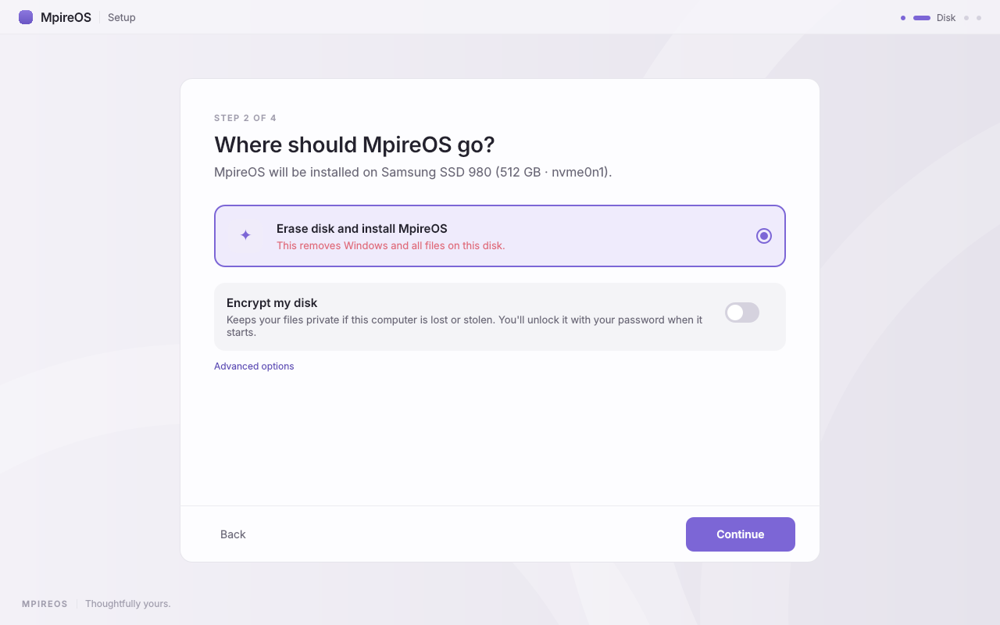
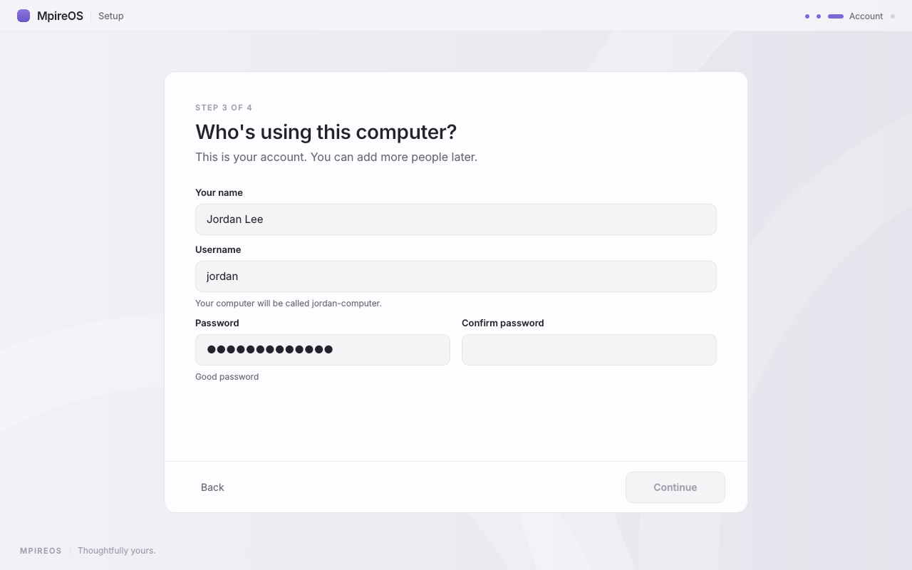
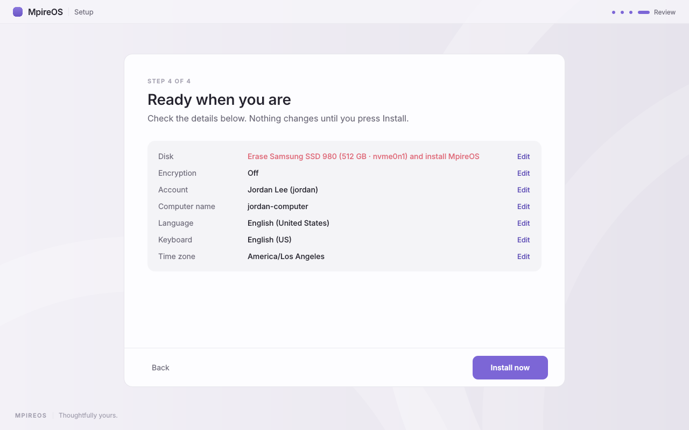
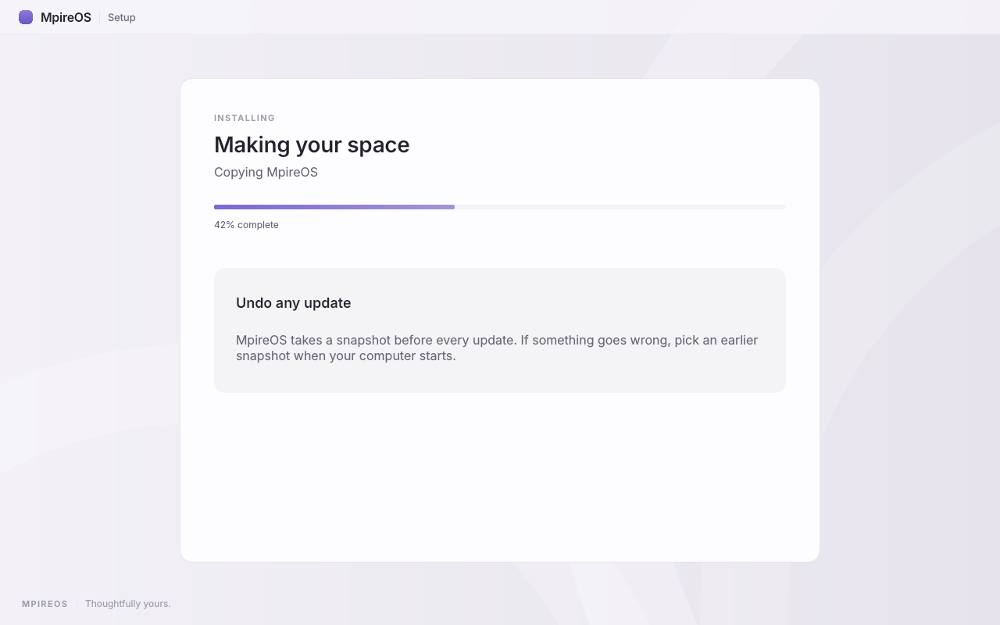
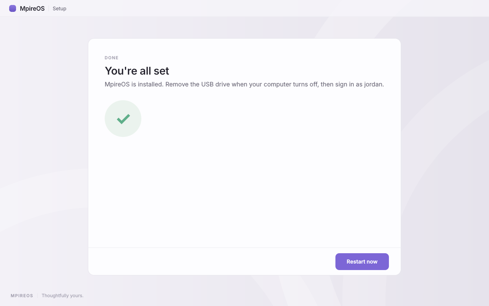

# Mpire Setup

The MpireOS installer: fully graphical, friendly, and asking only what it must. The flow is in [docs/architecture.md](../docs/architecture.md#installer) and the look follows [docs/design-system.md](../docs/design-system.md).

## Status

On the live ISO, Mpire Setup **opens full screen by itself** when the live session starts, and an "Install MpireOS" launcher reopens it after "Try it first". It lists the real disks (never the USB stick it booted from) and runs the backend, [`backend/mpire-install`](backend/README.md), as root through `sudo` with the plan the user built. Progress and errors come back as JSON lines.

Anywhere else (your own machine, `--demo`, or `tools/preview.py`) it shows sample disks and a simulated install, and never touches a disk.

Not yet: installing alongside another OS (the backend only erases a whole disk, so that option stays hidden), and detecting the time zone from the network (it uses the live system's, which is UTC; the user can change it on Review).

## The flow

1. **Welcome:** language (preselected), then Install or Try it first
2. **Disk:** erase the disk or install alongside the existing OS, plus an encryption switch
3. **Account:** name and password; username and computer name are suggested from the name
4. **Review:** everything in plain language, with Edit links for detected settings
5. **Installing:** progress and a short tour
6. **Done:** restart

## Layout

| Path | Contents |
|---|---|
| `qml/Main.qml` | Window, navigation, and footer buttons |
| `qml/pages/` | One file per screen |
| `qml/MpireSetup/` | Theme tokens, shared components, and `Installer.qml` (the plan, progress, and demo mode) |
| `src/main.cpp` | The native app (Qt 6) |
| `src/systembridge.*` | Disk detection and running `mpire-install` |
| `../packages/mpire-setup/` | The pacman package, built by CI into `[mpire]` |
| `../iso/airootfs/etc/xdg/autostart/mpire-setup.desktop` | Opens it when the live session starts |
| `tools/preview.py` | Run the UI with PySide6, or save screenshots of every screen |

## Running

Quick preview (no compiler needed):

```sh
pip install PySide6-Essentials
python3 installer/tools/preview.py
```

Native build (Qt 6.9+):

```sh
cmake -S installer -B build/installer && cmake --build build/installer
./build/installer/mpire-setup --windowed --demo
```

## Screenshots

Rendered from the current QML with `tools/preview.py --shots`.

| | |
|---|---|
|  |  |
|  |  |
|  |  |
